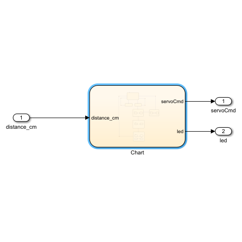
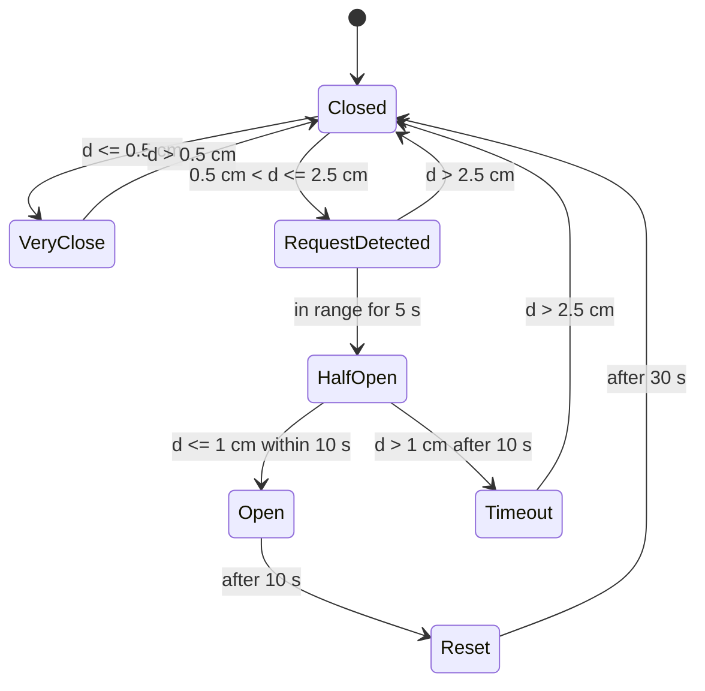

# Smart Garbage Bin Controller (Simulink / Stateflow)

Control logic for a touch-free smart garbage bin, modeled as a Stateflow state machine in Simulink. The controller reads the distance of a hand from a proximity sensor and decides how far to open the lid and what the status LED should do.

Developed for the **Model-Based Software Design** course (Politecnico di Torino, Master's in Mechatronics Engineering), Lab 2.



## The system

The bin has a hinged lid driven by a servo motor with three positions (closed, half open, fully open), a proximity sensor that measures how far a hand is from the bin, and a status LED. The controller sits between the sensor and the two actuators.

| Signal | Direction | Description |
|---|---|---|
| `distance_cm` | Input | Distance between the hand and the bin, in cm |
| `servoCmd` | Output | Lid position: `0` = closed, `90` = half open, `180` = open |
| `led` | Output | Status LED: off, on, or blinking (1 s on / 1 s off, i.e. 2 s period, 50% duty cycle) |

## How it behaves

A hand must stay in the "request" zone for a few seconds before the lid moves, so the bin does not open by accident. After the lid opens it closes by itself and the controller waits before accepting a new request.



| State | `servoCmd` | `led` | Meaning |
|---|---|---|---|
| `Closed` | 0 | off | Idle, waiting for a hand (initial state) |
| `VeryClose` | 0 | on | Hand too close to the sensor: lid stays closed, LED lit |
| `RequestDetected` | 0 | off | Hand is in the 0.5-2.5 cm zone: possible open request |
| `HalfOpen` | 90 | blinks once | Request confirmed after 5 s in the zone |
| `Open` | 180 | blinks once | Hand came within 1 cm during the half-open window |
| `Timeout` | 0 | blinks | Hand did not come close enough in time: lid closes and LED blinks until the hand moves away (> 2.5 cm) |
| `Reset` | 0 | blinks twice | Lid closed again after 10 s open, then a 30 s wait before returning to `Closed` |

Thresholds and timings used in the model: 0.5 cm, 1 cm and 2.5 cm for the distance; 5 s to confirm a request, 10 s to complete it, 10 s open time and a 30 s wait after closing.

## Design notes

- The logic is a single Stateflow chart with `distance_cm` as input and `servoCmd` and `led` as outputs.
- Timing is done with Stateflow temporal logic (`after`, `before`, `duration`), so no manual counters are needed.
- LED blinking is modeled with small ON/OFF sub-states switched by 1-second timers.
- Built following the MAAB modeling guidelines required by the course (naming conventions, model organization, structure).

## How to run

1. Open `control_logic.slx` in MATLAB (needs Simulink and Stateflow).
2. Drive `distance_cm` with a test signal, for example a Signal Editor or `From Workspace` block that moves a "hand" in and out of the 0.5-2.5 cm zone.
3. Watch `servoCmd` and `led` in a Scope, or watch the active states animate in the Stateflow chart.

## Repository contents

```
control_logic.slx     Simulink model with the Stateflow controller
docs/                 Images used in this README
```

## Author

Rawan El Halabi, Mechatronics Engineering student at Politecnico di Torino.
